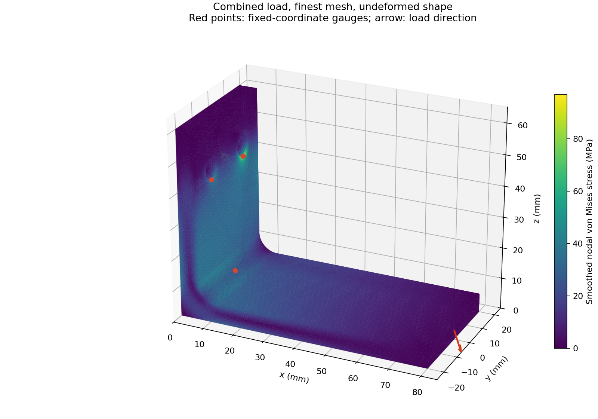

# How a bolted bracket bends

I built a repeatable bracket simulation because I wanted to know whether a stress plot was giving me a dependable answer. A picture alone cannot tell me that, so I first check a simple beam against a hand calculation, then make the bracket mesh smaller and see which results settle.

The model estimates how an aluminium L bracket moves and where stress builds up under three loads. A mesh divides the shape into small pieces; the solver calculates how those pieces stretch and bend. The report compares four mesh sizes and keeps the assumptions beside the numbers.

**Start with the [study report](docs/study/report.md)** for the beam check, all 12 bracket results and plots. To reproduce it, install the tools below and run `python -m fea.study all`.



## What I found

The beam check gives **0.45348 mm** tip movement versus **0.45714 mm** by hand, a **0.80%** difference. Its bending-stress field away from the fixed end has **0.18% RMS error** and **0.76% maximum pointwise error**.

The bracket's highest stress occurs near the fixed bolt holes. That attachment is idealized: I fix the hole walls in place rather than model bolt preload and contact. I track fixed physical points during refinement and report the moving global peak as well. A positive yield margin does not establish a safe working load, especially at a restraint edge where stress can depend on the mesh.

## Run it

Use Python 3.12 or newer and the native CalculiX solver. No containers are needed.

On Ubuntu 24.04:

```bash
sudo apt-get update
sudo apt-get install calculix-ccx libglu1-mesa libxrender1 libxcursor1 libxinerama1 libfltk1.3t64
python3 -m venv .venv
source .venv/bin/activate
python -m pip install -r requirements.txt
```

On an Apple Silicon Mac, install the solver with [the macOS Homebrew formula](https://github.com/costerwi/homebrew-calculix), then create the same Python environment:

```bash
brew install costerwi/homebrew-calculix/calculix-ccx
python3 -m venv .venv
source .venv/bin/activate
python -m pip install -r requirements.txt
```

The script finds `ccx` or Homebrew's `ccx_2.23`. Set `CCX` to another executable path if needed.

```bash
python -m pytest -q
python -m fea.study beam                 # quick hand-calculation comparison
python -m fea.study all                  # 1 beam + 3 peak-discovery + 12 bracket solves and report
# Optional: keep the committed report intact while exploring
python -m fea.study all --work build/trial --output build/trial-report
```

The full study includes three preliminary solves to locate peaks, then twelve refinement solves; run time depends on the machine. Each solver run has a ten-minute timeout and uses one thread. `build/` holds the input decks and raw solver outputs; the report folder holds plots, a CSV table and detailed JSON. When finished, remove the temporary files with `rm -rf build .venv`. The checked-in report remains readable without any installed tools.

## How I set up the model

The bracket has an 80 mm foot, a 60 mm upright, a 40 mm width, 6 mm walls and a rounded inside corner. Two 7 mm mounting holes are held fixed. I apply a downward force, a sideways force and a combination over the free end face. The report gives the coordinates and force values.

I use Gmsh to make quadratic tetrahedra, curved solid elements with ten nodes, and CalculiX to solve small-displacement linear elasticity. Everything uses newtons, millimetres and megapascals. I compare the combined normal and shear stress, called von Mises stress, against an assumed 276 MPa yield stress. The yield margin is `yield stress / calculated stress - 1` with no extra safety factor.

This is an idealized attachment study. It does not check bolt strength, slipping, fatigue, plastic deformation or a real assembly's working load. [The report](docs/study/report.md#assumptions-and-limits) explains those limits and the refinement results.

## Code and checks

- `fea/model.py` constructs the beam and bracket, embeds fixed-coordinate stress gauges and distributes end-face traction while preserving force and moment.
- `fea/solver.py` writes CalculiX decks and runs the solver with a timeout.
- `fea/analysis.py` contains the hand calculation and strict readers for solver result files.
- `fea/study.py` checks force/moment balance and load superposition, then records deck hashes and numerical results.
- `fea/report.py` regenerates the report and plots from solved fields.

There were no tests in the initial repository. The 30 tests cover hand calculations, stress conversion, malformed results, mesh/load checks and a real beam solve. CI runs them on Ubuntu, then solves all twelve bracket cases and checks force balance, moment balance and linear load superposition. Each run uploads its decks and report so I can inspect the actual solver results.
